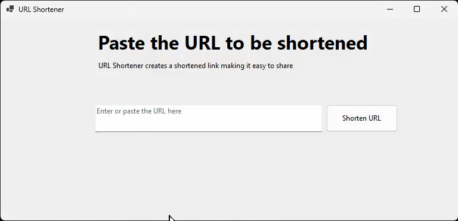

# URL Shortener

A small Windows desktop app that turns long web links into short, shareable ones. Paste a URL, click a button, and copy the result to your clipboard.

Built with C# and Windows Forms on .NET 8. Shortening is handled by the free [TinyURL](https://tinyurl.com) API, so no account or API key is needed.



## Features

- Paste a URL and shorten it in one click
- Input validation (only absolute `http://` and `https://` links are accepted)
- One-click copy of the short link to the clipboard
- Shows the original long URL next to the shortened one
- Clean, single-window interface with no visible tab headers
- Error message dialog if shortening fails (empty or invalid URL, no internet, service error)

## Requirements

- Windows 10 or later
- [.NET 8 SDK](https://dotnet.microsoft.com/download/dotnet/8.0) (to build from source)
- Visual Studio 2022 or later (optional, recommended)
- An internet connection

## Getting Started

### Visual Studio

1. Clone or download this repository.
2. Open `URL-Shortener.slnx`.
3. Press **F5** to build and run.

### Command line

```bash
git clone https://github.com/<your-username>/URL-Shortener.git
cd URL-Shortener
dotnet run
```

## Usage

1. Enter or paste a full link (for example `https://www.example.com/some/very/long/path`).
2. Click **Shorten URL**.
3. The result screen shows your short link and the original URL.
4. Click **Copy URL** to copy the short link, then share it.
5. Click **Shorten another URL** to start again.

## Project Structure

```
URL-Shortener/
├── assets/
│   └── URL_Shortener_Demo.gif   # Demo animation used in the README
├── MainForm.cs                  # UI logic: button handlers and tab navigation
├── MainForm.Designer.cs         # Designer-generated layout
├── MainForm.resx                # Form resources
├── UrlService.cs                # URL validation and TinyURL API call
├── Program.cs                   # Application entry point
├── URL-Shortener.csproj         # Project file (net8.0-windows, Windows Forms)
└── URL-Shortener.slnx           # Solution file
```

## How It Works

The interface is a single `TabControl` with its headers hidden (`FlatButtons` appearance and a 0x1 item size). The app switches pages in code only, and a `Selecting` handler blocks keyboard shortcuts such as Ctrl+Tab so users cannot change pages manually.

All network logic lives in `UrlService`:

- `IsValidUrl(string)` checks that the text is an absolute `http` or `https` URL.
- `ShortenAsync(string)` validates the input, calls `https://tinyurl.com/api-create.php?url=...`, and returns the short link. It uses a single shared `HttpClient` with a 10-second timeout.

Failures are thrown as standard exceptions (`ArgumentException`, `HttpRequestException`, `InvalidOperationException`). The form catches them and shows the message in a dialog, then clears the input box.

## Notes

- TinyURL's free endpoint is rate limited. Creating many links in a short time may cause requests to fail.
- Shortened links are created anonymously, so there is no click analytics or link management.

